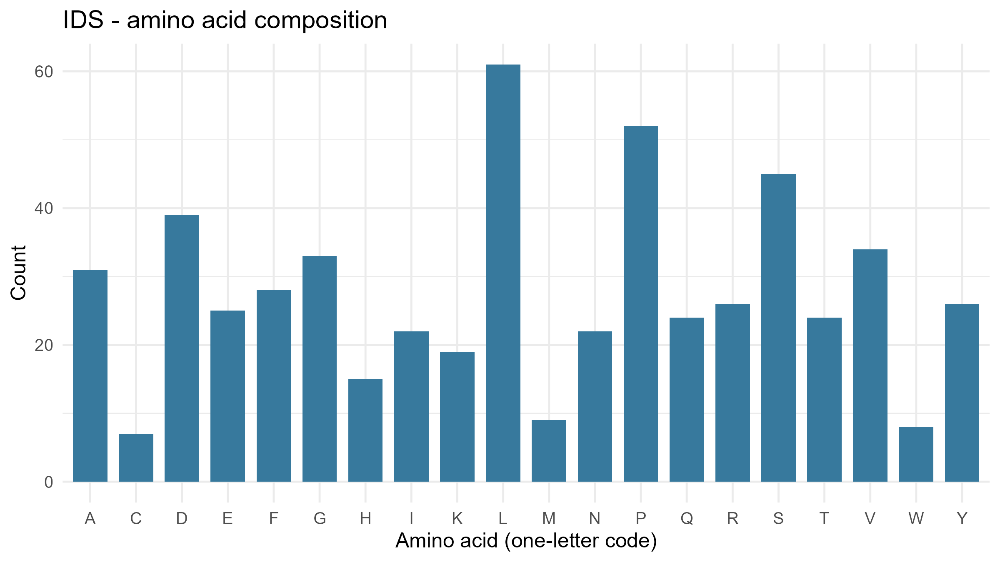
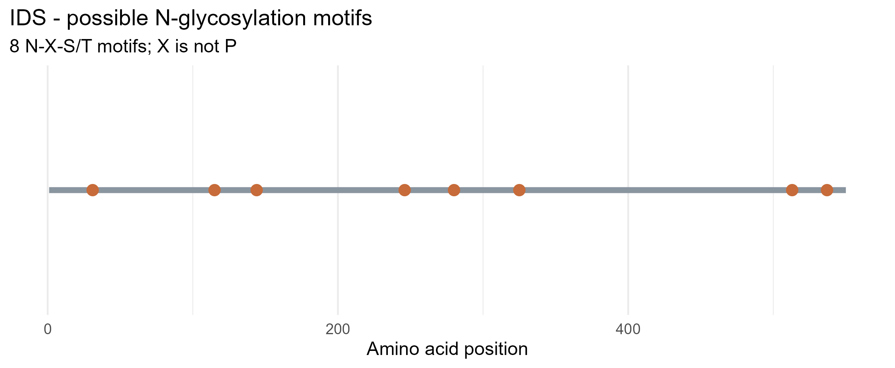

# Lysosomal Enzyme Analysis: IDS (Iduronate 2-Sulfatase)

**Gene:** IDS | **Protein:** iduronate 2-sulfatase, isoform a preproprotein | **Accession:** [NP_000193.1](https://www.ncbi.nlm.nih.gov/protein/NP_000193.1) | **Organism:** *Homo sapiens*

**Function:** IDS is a lysosomal sulfatase that removes the 2-O-sulfate group from iduronic acid in heparan sulfate and dermatan sulfate, so other enzymes can finish degrading them.

## Workflow

### Step 1: Select the enzyme and accession
On NCBI Protein, I searched `IDS Homo sapiens` and selected the full-length RefSeq record NP_000193.1 (550 aa).

### Step 2: Set up the repository and project
I created the public repository `lysosomal-enzyme-IDS` on GitHub, cloned it into RStudio as a project (File > New Project > Version Control > Git), and added `lysosomal_enzyme_analysis.R` to the project folder.

### Step 3: Edit the script
Only these two lines were changed:
```r
gene <- "IDS"
accession <- "NP_000193.1"
```

### Step 4: Install packages and run the script
```r
install.packages(c("rentrez", "ggplot2"))
```
I confirmed `getwd()` pointed to the project folder, then ran the whole script with **Source**.

### Step 5: Sequence downloaded from NCBI through R
The script does not use a local file. It downloads the FASTA record directly from NCBI with `rentrez`:
```r
fasta <- rentrez::entrez_fetch(db = "protein", id = accession,
                               rettype = "fasta", retmode = "text")
writeLines(fasta, file.path("data", paste0(gene, ".fasta")))
```
The saved file `data/IDS.fasta` has this header:
```
>NP_000193.1 iduronate 2-sulfatase isoform a preproprotein [Homo sapiens]
```

### Step 6: Console output
```
Analysis complete for IDS (NP_000193.1)
  gene   accession length_amino_acids potential_N_glycosylation_motifs
1  IDS NP_000193.1                550                                8

Five most common amino acids:
 amino_acid count percent
          L    61   11.09
          P    52    9.45
          S    45    8.18
          D    39    7.09
          V    34    6.18

Files saved in data/, results/, and figures/.
```

### Step 7: Files generated by the script

| Folder | File | Content |
|---|---|---|
| `data/` | `IDS.fasta` | Protein sequence from NCBI |
| `results/` | `IDS_summary.csv` | Length and motif count |
| `results/` | `IDS_amino_acid_counts.csv` | Counts and percentages for the 20 amino acids |
| `results/` | `IDS_motif_positions.csv` | Positions and sequences of N-X-S/T motifs |
| `figures/` | `IDS_amino_acid_composition.png` | Figure 1 |
| `figures/` | `IDS_potential_N_glycosylation.png` | Figure 2 |

## Results

### Amino acid composition
IDS is **550 amino acids** long. Leucine is the most common residue.



*Figure 1. Count of each amino acid in IDS (NP_000193.1).*

### Potential N-glycosylation motifs
The script searched for N-X-S/T, where X is not proline, and found **8** motifs:

| Position | Motif |
|---|---|
| 31 | NST |
| 115 | NFS |
| 144 | NHT |
| 246 | NIT |
| 280 | NIS |
| 325 | NST |
| 513 | NFS |
| 537 | NDS |



*Figure 2. Positions of the 8 potential N-glycosylation motifs along the 550-aa protein.*

## Answers to the Questions

**1. What does your enzyme normally break down inside lysosomes?**
Heparan sulfate and dermatan sulfate (glycosaminoglycans). IDS removes the sulfate group from iduronic acid residues, which lets other lysosomal enzymes continue the breakdown.

**2. What is the total length of your protein, and which amino acids are most common?**
550 amino acids. The most common are leucine (61, 11.09%), proline (52, 9.45%), serine (45, 8.18%), aspartate (39, 7.09%), and valine (34, 6.18%).

**3. How many potential N-glycosylation motifs did you find? Where are they located?**
Eight, at positions 31, 115, 144, 246, 280, 325, 513, and 537 (see the table above).

**4. Why can glycosylation matter for lysosomal proteins? Does finding a motif prove the protein is glycosylated?**
N-glycans on lysosomal enzymes can be modified with a mannose-6-phosphate (M6P) tag. M6P receptors recognize this tag and sort the enzyme to the lysosome. Glycosylation also helps folding and stability. **No.** N-X-S/T only predicts a possible site. It does not show that a glycan is attached, that the site is used, or that an M6P tag is present.

**5. What could happen in the cell if your enzyme did not work properly?**
Heparan sulfate and dermatan sulfate would accumulate in lysosomes and disrupt cell function. In humans, IDS deficiency causes mucopolysaccharidosis type II (MPS II, Hunter syndrome), an X-linked lysosomal storage disease.

## Repository Contents
```
lysosomal_enzyme_analysis.R
data/      IDS.fasta
results/   IDS_summary.csv, IDS_amino_acid_counts.csv, IDS_motif_positions.csv
figures/   IDS_amino_acid_composition.png, IDS_potential_N_glycosylation.png
```

**Note:** N-X-S/T is a potential N-glycosylation motif, not confirmation of a glycan or an M6P tag. Sequence analysis does not measure enzyme activity.